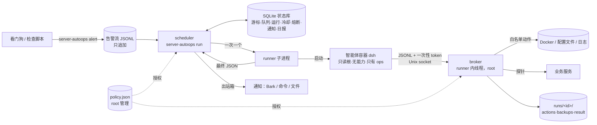
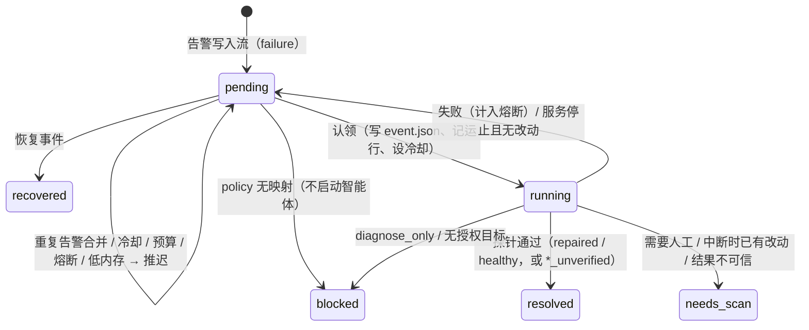

# 架构

## 组件和数据流



| 文件 | 作用 |
|---|---|
| `server_autoops/scheduler.py` | 常驻主循环：读告警流（持久游标）、拆分/合并/取消事件、预算和熔断、内存闸门、启动 runner、通知出站箱、日报、保留期清理 |
| `server_autoops/runner.py` | 一次运行：启动 broker、准备智能体（dsh 容器 / 模拟 / 无）、超时和取消、向 broker 要最终结论 |
| `server_autoops/broker.py` | 唯一能动宿主的部件：按 policy 执行 10 种 `ops` 操作、探针、配置事务、审计 |
| `server_autoops/policy.py` | policy 校验（scheduler 和 broker 都用） |
| `server_autoops/mock_agent.py` | 模拟智能体，和 dsh 插件用同一协议 |
| `server_autoops/notify.py`、`relay.py` | 通知后端；`alert` 命令 |
| `server_autoops/doctor.py`、`demo.py` | 自检；离线演示 |
| `plugin/index.mjs` | dsh 里唯一的工具 `ops`：校验工具清单只剩自己，把请求转给 broker socket |
| `agent-image/Dockerfile` | 智能体镜像：Node + 固定版本的 dsh |

## 一条告警的一生



要点：

- **告警流**：第一次启动从文件末尾开始（不重放历史）。之后按 inode 跟踪：轮转后旧文件的尾巴照样读完，新文件从头读；截断或同 inode 重写靠 64 字节检查点识别；半行等写完整再处理；超长行和坏行进隔离表和 `*.errors.jsonl`。旧文件在停机期间被删掉、尾巴读不到时，记一条隔离记录并发 `stream_loss` 通知。
- **入队**：告警先脱敏再存。同一 `service:code` 已在排队就合并（记录最多 20 次观测）；组合码拆开；恢复事件取消排队中的项。
- **认领**：先把没有映射的标成 blocked；内存不够时整体推迟；按冷却、熔断、每小时、每天预算算出最早可运行时间；都满足才认领。认领和写运行记录在同一个事务里。
- **结论**：runner 进程退出码为 0、结果 `status` 为 repaired/healthy、`verified` 为真，三者都满足才算成功。只有 `running` 探针的目标，成功记为 `repaired_unverified` / `healthy_unverified`。
- **重启恢复**：scheduler 启动时检查没结束的运行：有可信结果就采用（但「已核实成功」却没看到退出码的，转人工）；审计里有改动或结果不完整的转人工；什么都没发生的安全重排。

## 一次运行里发生什么

1. scheduler 在 `runs/<id>/` 写 `event.json`，以 `python3 -I bin/server-autoops.py runner ...` 启动 runner（新会话、独立进程组）。
2. runner 拿全局智能体锁，读并校验 policy，创建 broker，在 `runs/<id>/bridge/broker.sock` 上监听，生成一次性 token。
3. dsh：新建 `runs/<id>/home/.dsh/`（headless profile、禁用插件列表、模型配置），`docker run` 智能体容器；模拟：启动 mock 智能体子进程；disabled：跳过。
4. 智能体先 `inventory`，然后 `inspect`/`logs`/`read_config`，必要时 `start`/`restart`/`recreate`/`patch_config`，最后 `finish`。
5. 智能体退出或超时后，runner 删除容器，**自己再调用一次 `finish`**：broker 对所有授权目标跑探针，结合审计里的改动，写 `result.json`。
6. runner 把结果 JSON 打到标准输出（scheduler 读最后一行），退出码 0 表示核实成功。

## 状态库表

| 表 | 内容 |
|---|---|
| `cursors` | 每个被跟踪的告警流 inode：偏移、半行缓存、检查点 |
| `queue` | 告警：pending / running / resolved / needs_scan / blocked / recovered |
| `runs` | 每次运行：开始结束时间、结论、退出码、摘要 |
| `cooldowns` | `service:code` 冷却到期时间 |
| `breakers` | 每个告警 service 的连续失败数和熔断到期时间 |
| `notifications` | 出站箱：pending / sending / sent / suppressed，带去重键和重试时间 |
| `daily_reports` | 每天一份日报 |
| `quarantines` | 坏行、丢失的尾巴（脱敏后） |
| `metadata` | 初始化标记、上次清理时间 |

## 运行目录

```
runs/<run_id>/
  event.json        本次告警（脱敏后）
  output.log        runner 的标准输出（最后一行是结果 JSON）
  agent.jsonl       智能体输出（dsh 的 JSON 事件流，或模拟智能体的请求和回复）
  actions.jsonl     broker 审计：每个改动、回滚
  backups/          改配置前的原文件（保持属主和权限）
  result.json       broker 的最终结论
  home/             dsh 的一次性 home（kind=dsh）
  bridge/           broker socket（运行结束即删除）
```
